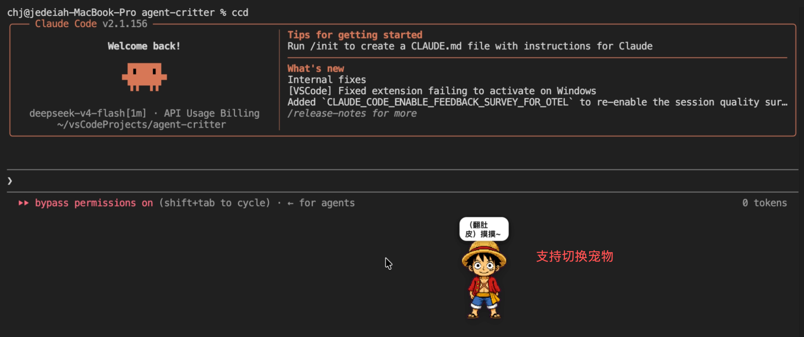
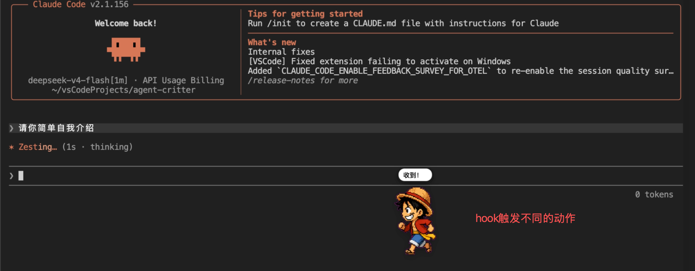
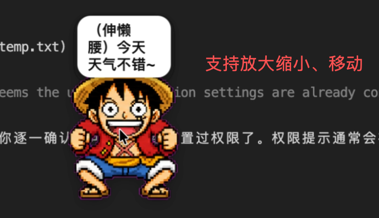

# PawPeek 🐾

會探頭看你 AI 在忙什麼的桌寵。PawPeek 是 Claude Code 插件，用一隻透明背景、浮在桌面上的小寵物，即時反映 Claude Code 的工作狀態：閒置、工作中、等你確認、出錯。

> **原出處**：本專案 fork 自 [Jedeiah/agent-critter](https://github.com/Jedeiah/agent-critter)（MIT License），
> 感謝原作者 chj 與 Agent Critter Contributors。PawPeek 在其基礎上改名並大幅修改，
> 原始版權聲明保留於 [LICENSE](LICENSE)。

| 待機 | 工作中 | 放大 |
|------|--------|------|
|  |  |  |

## 與原版的差異

| 項目 | PawPeek |
|------|---------|
| 介面語言 | 繁體中文 |
| 對話泡泡 | 寵物頭上的打字泡泡；靠近螢幕上緣時自動改到下方，視窗跟著泡泡伸縮、寵物位置不動 |
| 自訂文字 | 所有提示文字集中在 `messages.json`，可自行修改 |
| 自訂外觀 | `.env` 的 `PET_SKIN` 指定 Petdex 名稱或本機 spritesheet；`/skin` 選檔匯入、`/set-skin` 切換 |
| Petdex 精靈 | 本機沒有時自動從 [petdex.dev](https://petdex.dev) 下載 |
| 焦點 | 不搶焦點；點寵物後焦點會還給原本的程式 |
| 置頂 | 只在啟動時置頂一次，不會打斷全螢幕遊戲/影片 |
| 回到身邊 | 按 `c` 讓寵物跑到目前作用中的視窗旁 |
| 多螢幕 | 跨不同縮放比例的螢幕時自動校正大小與位置 |
| 通訊埠 | 改用 47390（避開常被代理軟體佔用的 7890） |
| 設定位置 | 文件資料夾下 `.pawpeek/`；舊的 `.agent-critter/` 會自動搬過來 |

## 安裝（本機）

需求：Windows 10/11（WebView2）、[Rust](https://rustup.rs)、Claude Code。

```powershell
# 編譯並打包到 dist\pawpeek-plugin-windows
.\scripts\build-plugin.bat
```

在 Claude Code 裡：

```
/plugin marketplace add C:\path\to\pawpeek\dist\pawpeek-plugin-windows
/plugin install pawpeek@pawpeek
/reload-plugins
```

開新的對話時桌寵會自動出現。改完程式碼後如何更新已安裝的插件，請見 [PLUGIN.md](PLUGIN.md)。

## 使用

| 操作 | 效果 |
|------|------|
| 單擊寵物 | 隨機互動文字與動作（點頭、點身體各有不同台詞） |
| 雙擊寵物 | 顯示目前對話數與狀態 |
| 拖曳 | 移動位置 |
| 右鍵 | 選單：調整大小、離開 |
| `+` / `-` | 縮放 0.5x ~ 1.5x |
| `c` | 跑到目前作用中的視窗旁 |

### 斜線指令

| 指令 | 說明 |
|------|------|
| `/skin` | 跳出選檔視窗匯入自訂外觀，預覽後確認 |
| `/set-skin [名稱\|路徑\|default]` | 切換外觀；不帶參數會列出可用外觀 |
| `/quit` | 讓桌寵離開（下次開新對話會再出現） |

### 狀態對應

| Claude Code 狀態 | 寵物動作 |
|------------------|----------|
| 閒置 | 呼吸待機，偶爾自言自語 |
| 工作中 | 左右奔跑 |
| 等待確認（權限請求） | 等待 |
| 工具出錯 / 限流 | 檢查 |
| 嚴重錯誤（認證、帳單、模型） | 崩潰 |

多個對話同時進行時取最高優先：`嚴重錯誤 > 工具出錯 > 等待確認 > 工作中 > 閒置`。

## 設定檔

位於「文件」資料夾下的 `.pawpeek/`（首次啟動自動產生範本）：

| 檔案 | 用途 |
|------|------|
| `messages.json` | 所有提示文字；陣列會隨機挑一句，`{count}`、`{name}`、`{state}` 自動帶入 |
| `.env` | `PET_SKIN=`：Petdex 名稱、本機圖片路徑，或留空用內建寵物 |
| `pets/<名稱>/spritesheet.webp` | 下載或匯入的外觀 |

視窗位置、縮放比例存在 `~/.pawpeek/data/`。

外觀也會從 `~/.codex/pets/`、`~/.petdex/pets/` 讀取（與 Petdex 相容）。spritesheet 格式為 8 欄 × 9 或 11 列，png 或 webp。

## 架構

```
Claude Code hooks ──TCP 127.0.0.1:47390──▶ 狀態機（多對話合併）──▶ WebView（CSS 逐格動畫）
```

| 層 | 技術 |
|----|------|
| 視窗 | wry + tao（Windows WebView2 / macOS WKWebView） |
| 狀態 | Rust 狀態機，依優先順序合併多個對話 |
| Hook | Claude Code plugin hooks，見 [`hooks/hooks.json`](hooks/hooks.json) |
| 精靈 | Petdex spritesheet |

## 移除

```
/plugin uninstall pawpeek@pawpeek
```

要一併清除設定，刪除「文件」下的 `.pawpeek/` 與 `~/.pawpeek/`。

## 致謝

- [Jedeiah/agent-critter](https://github.com/Jedeiah/agent-critter) — 本專案的原始專案
- [Petdex](https://github.com/crafter-station/petdex) — 精靈格式與社群精靈
- [wry](https://github.com/tauri-apps/wry)、[tao](https://github.com/tauri-apps/tao) — Rust WebView 與視窗

## 授權

[MIT](LICENSE)。保留原專案版權聲明，PawPeek 的修改部分版權屬 BM.Liao。
