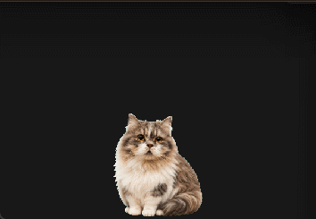
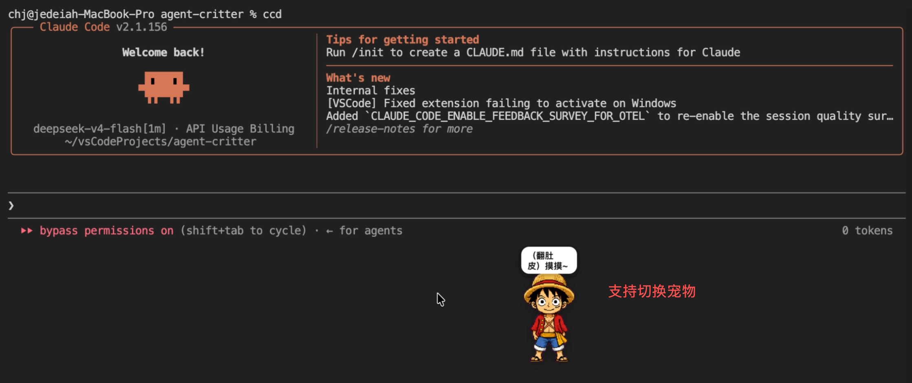
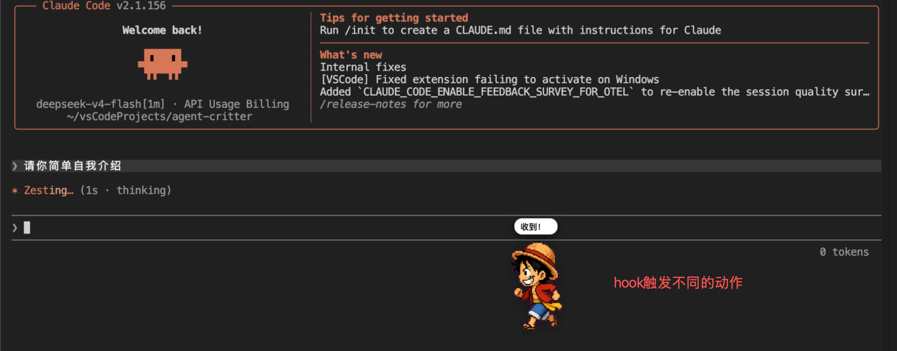
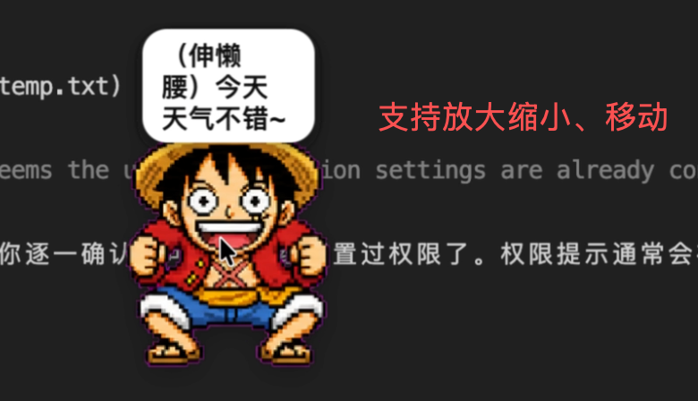

# PawPeek 🐾

會探頭看你 AI 在忙什麼的桌寵。PawPeek 是 Claude Code 插件，用一隻透明背景、浮在桌面上的小寵物，即時反映 Claude Code 的工作狀態：閒置、工作中、等你確認、出錯。

> **🤖 AI 開發專案**：PawPeek 的程式碼、文件與修改內容由 AI（Anthropic Claude，透過 Claude Code）撰寫完成。
> 想法、需求與測試回饋來自 BM.Liao，實作則是 AI 完成的。使用前請自行評估；如有問題歡迎回報。

> **原出處**：本專案 fork 自 [Jedeiah/agent-critter](https://github.com/Jedeiah/agent-critter)（MIT License），
> 感謝原作者 chj 與 Agent Critter Contributors。PawPeek 在其基礎上改名並大幅修改，
> 原始版權聲明保留於 [LICENSE](LICENSE)。

## Demo



| 待機 | 工作中 | 放大 |
|------|--------|------|
|  |  |  |

## 與原版的差異

| 項目 | PawPeek |
|------|---------|
| 介面語言 | 繁體中文 |
| 對話泡泡 | 寵物頭上的打字泡泡；靠近螢幕上緣時自動改到下方，視窗跟著泡泡伸縮、寵物位置不動 |
| 自訂文字 | 所有提示文字集中在 `messages.json`，可自行修改 |
| 自訂外觀 | `.env` 的 `PET_SKIN` 指定 Petdex 名稱或本機 spritesheet；`/skin` 選檔匯入、`/set-skin` 切換 |
| Petdex 精靈 | 本機沒有時自動從 [petdex.dev](https://petdex.dev) 下載 |
| 焦點 | 啟動時不搶焦點；點寵物才取得焦點（系統預設行為） |
| 置頂 | 只在啟動時置頂一次，不會打斷全螢幕遊戲/影片 |
| 啟動位置 | 沿用上次位置；不在任何螢幕上時重置到作用中視窗旁 |
| 多螢幕 | 跨不同縮放比例的螢幕時自動校正大小與位置 |
| 通訊埠 | 改用 47390（避開常被代理軟體佔用的 7890） |
| 設定位置 | 文件資料夾下 `.pawpeek/`；舊的 `.agent-critter/` 會自動搬過來 |

## 安裝

需求：Windows 10/11（WebView2 Runtime，Win11 內建）或 macOS（Apple Silicon），以及 [Claude Code](https://docs.claude.com/en/docs/claude-code)。

### 方式一：直接從 GitHub 安裝（建議，免 clone、免編譯）

repo 本身就是 Claude Code marketplace，`bin/` 內含 CI 編好的執行檔。在 Claude Code 對話中輸入：

```
/plugin marketplace add bmLiao/pawpeek
/plugin install pawpeek@pawpeek
/reload-plugins
```

或在終端機用 CLI：

```powershell
claude plugin marketplace add bmLiao/pawpeek
claude plugin install pawpeek@pawpeek
```

也可以直接交給 Claude：在 Claude Code 裡說「幫我安裝 https://github.com/bmLiao/pawpeek 這個插件」，它會執行上面的指令。

#### 保持最新版

**建議開啟自動更新**：第三方 marketplace 預設不會自動更新。在 Claude Code 輸入 `/plugin`，
切到 **Marketplaces** 分頁、選 `pawpeek`，再選 **Enable auto-update**。之後送出每個對話的第一則訊息後，
Claude Code 會在 10 分鐘內自動抓新版，看到「Plugin updated」提示時執行 `/reload-plugins` 或重開即可。

沒開自動更新也沒關係：桌寵每次啟動會檢查一次，有新版就在第一次待機時冒泡泡提醒你，留到狀態改變（包括拖曳寵物）為止（可在 `.env` 設 `UPDATE_CHECK=off` 關閉）。
手動更新：

```
/plugin marketplace update pawpeek
/plugin update pawpeek@pawpeek
/reload-plugins
```

> 若環境變數設了 `DISABLE_AUTOUPDATER=1` 或 `CLAUDE_CODE_DISABLE_NONESSENTIAL_TRAFFIC=1`，自動更新會整個停用；
> 想保留插件自動更新可另外設 `FORCE_AUTOUPDATE_PLUGINS=1`。

### 方式二：從原始碼編譯（開發用）

需要另外安裝 [Rust](https://rustup.rs) 與 Git。

```powershell
git clone https://github.com/bmLiao/pawpeek.git
cd pawpeek

# 編譯並打包到 dist\pawpeek-plugin-windows（此資料夾就是本機 marketplace）
.\scripts\build-plugin.bat
```

```
/plugin marketplace add C:\path\to\pawpeek\dist\pawpeek-plugin-windows
/plugin install pawpeek@pawpeek
/reload-plugins
```

改完程式碼後如何更新已安裝的插件，請見 [PLUGIN.md](PLUGIN.md)。

> 兩種方式的 marketplace 名稱都是 `pawpeek`，切換時先 `/plugin marketplace remove pawpeek` 再重新加入。
> 若 shell 設了 `CLAUDE_CONFIG_DIR`，插件會裝到該設定目錄，而不是 `~/.claude`。

### 確認

開一個新的 Claude Code 對話，狀態列出現「桌寵小精靈上線中...」，接著桌寵出現在桌面上即安裝成功。
也可以用 `/plugin` 查看 `pawpeek@pawpeek` 是否已啟用。

### GitHub Copilot（🧪 測試中）

> **測試中，尚未正式支援。** 1.3.3 起才支援 Copilot（1.3.2 以前在 Copilot 上不會動作），建議使用最新版（1.3.4 起寵物常駐、有 F1 面板）。以下是目前的進度，正式支援後會更新這一節。

VS Code 的 Copilot 與 Copilot CLI 都能載入 Claude 格式的插件並執行裡面的 hook，所以 PawPeek 直接沿用同一個 repo（`bmLiao/pawpeek`），不另外發布。

| 項目 | 狀態 |
|------|------|
| Copilot CLI（Windows） | ✅ 開發版實測可用：開始對話、工作中、結束都會反應，不會擋住工具呼叫；寵物常駐不會被關掉 |
| VS Code Copilot（Windows） | ✅ 開發版實測可用（從本機資料夾載入）：開始、工作中、完成（`Stop`）、結束都會反應；需開啟 `chat.plugins.enabled`，**和 Claude Code 是各裝各的** |
| 從 VS Code 的插件市集安裝 | ✅ 認得本 repo 的 `marketplace.json`，加入市集後可看到並安裝 PawPeek；VS Code 會沿用之前抓過的那份 repo，新版推出後要執行「Chat: Update Plugins」才會看到 |
| 換外觀 / 讓寵物離開 | Copilot 沒有 `/set-skin`、`/skin`、`/quit` 指令（不讀 `commands/`），改用寵物的 **F1 面板**換外觀、**Esc** 讓寵物離開 |
| 等待確認狀態 | ⏳ 尚未確認（Copilot 的 `permissionRequest` 每次工具呼叫都會送，不能當成「等你確認」） |
| macOS | ⏳ 尚未測試 |
| Copilot CLI 一次性模式（`-p`） | ⚠️ 結束時有時收不到結束事件，寵物會停在工作中直到 30 分鐘逾時 |

安裝（VS Code）：設定開啟 `chat.plugins.enabled` →「Chat: Open Customizations」→ Configure Marketplaces → 加入 `bmLiao/pawpeek` → 安裝 PawPeek。
更新：VS Code 執行「Chat: Update Plugins」（或開啟擴充功能自動更新）。看到的版本比 GitHub 上舊時，也是執行這個指令重新抓。在 Claude Code 跑 `/plugin update` 不會更新 VS Code 那份。

開發測試（從本機資料夾載入）：VS Code 設定加入 `"chat.pluginLocations": { "<插件資料夾>": true }`。
VS Code 會把插件複製到 `%APPDATA%\Code\agentPlugins\` 再執行，改了插件之後要執行「Chat: Update Plugins」或重新載入視窗，它才會重新複製。

## 使用

| 操作 | 效果 |
|------|------|
| 單擊寵物 | 依目前狀態隨機說一句（待機時加一個小動作）；「等你確認」時是清掉這則提示，換下一個等確認的對話 |
| 雙擊寵物 | 顯示目前對話數與狀態 |
| 拖曳 | 移動位置；待機時按住就會說話，並依滑鼠左右方向轉身，放開後動作播完才回待機 |
| `[` / `]` | 縮小 / 放大（0.5x ~ 1.5x，點一下寵物後可用） |
| F1 | 開關換外觀面板：輸入 Petdex 名稱按 Enter 換外觀、「📁 匯入」自訂外觀、「🌐 Petdex」（用瀏覽器開 https://petdex.dev/） |
| F3 | 開關小寵物：右下角三隻同外觀的小寵物（待機時各自動作，其他狀態跟寵物一致） |
| F4 | 開關快捷鍵說明 |
| Esc | 開關離開面板，按「👋 離開」讓寵物離開（下次開新對話會再出現）；F1 / F4 面板開著時是關閉它 |

鍵盤操作要先點一下寵物才有作用，同一個鍵再按一次就關閉。寵物在執行對話的程式（Claude Code、VS Code、Copilot CLI）都關掉後才會自己離開，只結束單一對話（例如 VS Code 開新聊天）不會離開。完成、等待確認或出錯的泡泡第一行會顯示是哪個資料夾的對話（例如 `📁 pawpeek`），同時開好幾個對話時方便分辨；不會切換或搶走視窗焦點。

### 斜線指令

| 指令 | 說明 |
|------|------|
| `/skin` | 跳出選檔視窗匯入自訂外觀，預覽後確認 |
| `/set-skin [名稱\|路徑\|default]` | 切換外觀；不帶參數會列出可用外觀 |
| `/quit` | 讓桌寵離開（下次開新對話會再出現） |

### 狀態對應

| Claude Code 狀態 | 寵物動作 |
|------------------|----------|
| 閒置 | 呼吸待機，偶爾自言自語 |
| 工作中 | 原地奔跑 |
| 等待確認（權限請求） | 等待 |
| 限流 / 伺服器錯誤 | 檢查（單一工具失敗不算，維持工作中） |
| 嚴重錯誤（認證、帳單、模型） | 崩潰 |

完整的動作與說話規則見 [docs/BEHAVIOR.md](docs/BEHAVIOR.md)。

多個對話同時進行時取最高優先：`等待確認 > 嚴重錯誤 > 工具出錯 > 工作中 > 閒置`（等待確認代表 Claude 正停下來等你，最需要注意）。

某個對話停在工作中、等待確認或工具出錯超過 30 分鐘沒有任何動靜（例如終端機被直接關掉），會自動回到閒置；嚴重錯誤則保留到你下一次操作。

## 設定檔

位於「文件」資料夾下的 `.pawpeek/`（首次啟動自動產生範本）：

| 檔案 | 用途 |
|------|------|
| `messages.json` | 所有提示文字，說明見下方〈自訂台詞〉 |
| `.env` | `PET_SKIN=`：Petdex 名稱、本機圖片路徑，或留空用內建寵物；`UPDATE_CHECK=off` 關閉新版提醒 |
| `pets/<名稱>/spritesheet.webp` | 下載或匯入的外觀 |

視窗位置、縮放比例存在 `~/.pawpeek/data/`。

外觀也會從 `~/.codex/pets/`、`~/.petdex/pets/` 讀取（與 Petdex 相容）。spritesheet 格式為 8 欄 × 9 或 11 列，png 或 webp。

### 自訂台詞（`messages.json`）

位置：`文件\.pawpeek\messages.json`（例如 `C:\Users\<你>\Documents\.pawpeek\messages.json`）。

- 改完存檔，下次啟動桌寵就會讀入。
- 陣列會隨機挑一句；字串可以改成陣列（反過來也可以）。刪掉某個欄位會改用內建預設值；`folder.tag` 清空就不顯示資料夾名稱。
- 升級後，新版新增的欄位會在啟動時自動補進檔案，你改過的內容不會被蓋掉。
- 檔案不是合法 JSON 時不會動它，桌寵改用內建預設值。

| 欄位 | 用途 |
|------|------|
| `state_bubble` | 進入該狀態時一直顯示的台詞（`running` 工作中、`need_confirm` 等你確認、`tool_error` 工具出錯、`error_final` 執行失敗） |
| `state_label` | 雙擊時 `{state}` 顯示的狀態名稱 |
| `chatter` | 各狀態的自言自語（停留同一狀態時隨機說、單擊時說一句；`dragging` 是拖曳中） |
| `done` | 工作完成回到待機時說的話 |
| `greeting` / `goodbye` | 打招呼 / 告別 |
| `dblclick` | 雙擊回報對話數與狀態（`idle_none` 是沒有對話時） |
| `zoom.changed` | 用 `[` / `]` 縮放時的提示 |
| `minis` | F3 小寵物登場（`on`）/ 退場（`off`）時說的話 |
| `folder.tag` | 完成、等待確認、出錯泡泡第一行的資料夾名稱 |
| `help` | F4 快捷鍵說明：`title` 標題、`keys` 說明表（`"按鍵": "說明"`，一行一列，可增刪） |
| `update.available` | 有新版時的提醒 |
| `skin` | 換外觀（`/pawpeek:set-skin`）的提示 |
| `panel` | F1 換外觀面板、Esc 離開面板的文字 |
| `import` | 匯入自訂外觀（`/pawpeek:skin`）的對話框 |

參數寫在台詞裡會自動換成實際的值，只在列出的欄位有效：

| 參數 | 意思 | 可用欄位 |
|------|------|----------|
| `{count}` | 目前的對話數 | `dblclick.*` |
| `{state}` | 狀態名稱（取自 `state_label`） | `dblclick.other` |
| `{scale}` | 縮放倍率 | `zoom.changed` |
| `{folder}` | 對話所在的資料夾名稱 | `folder.tag` |
| `{latest}` / `{current}` | 最新版本 / 目前版本 | `update.available` |
| `{name}` | 外觀名稱或圖片檔名 | `skin.downloading` / `not_found` / `image_error`、`panel.not_found` / `bad_image`、`import.read_error` / `not_image` / `confirm` / `saved` |
| `{err}` | 存檔失敗的錯誤訊息 | `panel.save_error`、`import.save_error` |
| `{w}` / `{h}` | 圖片寬 / 高 | `import.bad_size` |
| `{rows}` | 圖片列數 | `import.confirm` |

## 架構

```
Claude Code hooks ──TCP 127.0.0.1:47390──▶ 狀態機（多對話合併）──▶ WebView（CSS 逐格動畫）
```

| 層 | 技術 |
|----|------|
| 視窗 | wry + tao（Windows WebView2 / macOS WKWebView） |
| 狀態 | Rust 狀態機，依優先順序合併多個對話 |
| Hook | Claude Code plugin hooks，見 [`hooks/hooks.json`](hooks/hooks.json) |
| 精靈 | Petdex spritesheet |

## 移除

```
/plugin uninstall pawpeek@pawpeek
```

要一併清除設定，刪除「文件」下的 `.pawpeek/` 與 `~/.pawpeek/`。

## 致謝

- [Jedeiah/agent-critter](https://github.com/Jedeiah/agent-critter) — 本專案的原始專案
- [Petdex](https://github.com/crafter-station/petdex) — 精靈格式與社群精靈
- [wry](https://github.com/tauri-apps/wry)、[tao](https://github.com/tauri-apps/tao) — Rust WebView 與視窗

## 開發方式

| 角色 | 負責 |
|------|------|
| BM.Liao | 想法、功能需求、使用測試與回饋 |
| AI（Anthropic Claude，Claude Code） | 程式碼實作、除錯、文件撰寫 |

git commit 中的 `Co-Authored-By: Claude` 標示了 AI 參與的部分。

## 授權

[MIT](LICENSE)。保留原專案版權聲明；PawPeek 的修改由 AI 依 BM.Liao 的需求完成。
