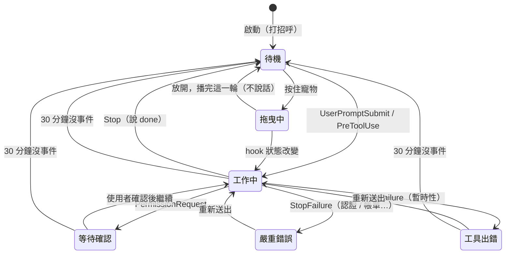

# PawPeek 動作與說話規格

> 這份文件是寵物「什麼時候做什麼動作、說什麼話」的**唯一規格**。
> 修改狀態、動畫、泡泡、台詞、互動（拖曳 / 單擊 / 雙擊 / 縮放）、自言自語、更新提醒等相關程式前先讀這份，
> 改完把變動同步回來（含「變更紀錄」）。程式與文件不一致時，以使用者確認過的這份規格為準，再修程式。

## 0. 總覽

細節見後面各章；這裡把狀態、循環與寵物的變化集中成一頁。

### 0.1 狀態總表

| 狀態 | 前端名稱 | 怎麼進入 | 怎麼離開 | 主動畫（列・格數・一輪） | 進入時說 | 停留時的台詞 | 自言自語時的動作 | 單擊時的動作 | 優先 |
|------|---------|---------|---------|------------------------|---------|-------------|----------------|-------------|------|
| 待機 | `idle` | `Stop`、`SessionStart`、`Notification`（idle_prompt）、30 分鐘逾時、拖曳放開 | 任何 hook 狀態改變；按住寵物 | `idle`・0・6 格・約 6.6 秒（慢速） | 從工作中回來：`done`；從其他狀態回來：`chatter.idle`；剛啟動：不說（接打招呼）；拖曳回來：不說 | 無持久台詞 | 隨機 `jumping` / `waving` / `review` 5 秒 | 隨機 `waving` / `jumping` / `waiting` / `review` 2 秒 | 5（最低） |
| 拖曳中 | `dragging` | 待機時按住 >150ms 或開始移動；非待機時按著直到轉回待機 | 放開後播完這一輪 `jumping` → 待機；hook 狀態改變 → 直接切過去 | `jumping`・4・5 格・0.84 秒，往左水平翻轉 | `chatter.dragging`（持久） | 同左，一直顯示 | 不說 | 不會發生（按著就是拖曳） | 屬於待機底下 |
| 工作中 | `running` | `UserPromptSubmit`、`PreToolUse`、`PostToolUse`、`PreCompact`、未中斷的 `PostToolUseFailure` | 其他 hook；30 分鐘沒事件 → 待機 | `running`・7・6 格・0.82 秒 | `state_bubble.running`（持久） | 持久台詞；自言自語 `chatter.running` 暫時蓋過 4 秒 | 不換動作 | 只說話 | 4 |
| 等待確認 | `waiting` | `PermissionRequest`、`Notification`（permission_prompt / elicitation_dialog） | 其他 hook；30 分鐘沒事件 → 待機 | `waiting`・6・6 格・約 1.0 秒 | `state_bubble.need_confirm`（持久） | 同上，`chatter.waiting` | 不換動作 | 只說話 | 1（最高） |
| 工具出錯 | `review` | `StopFailure`（rate_limit、server_error、未知） | 其他 hook；30 分鐘沒事件 → 待機 | `review`・8・6 格・約 1.0 秒 | `state_bubble.tool_error`（持久） | 同上，`chatter.review` | 不換動作 | 只說話 | 3 |
| 嚴重錯誤 | `failed` | `StopFailure`（認證、帳單、模型、invalid_request 等） | 只有下一次 hook 事件（不逾時） | `failed`・5・8 格・約 1.2 秒 | `state_bubble.error_final`（持久） | 同上，`chatter.failed` | 不換動作 | 只說話 | 2 |

- 「優先」是多對話合併時的順序，數字小的贏。
- 所有狀態都能雙擊（`dblclick.*` 暫時 3 秒）與 `[` / `]` 縮放（特殊 1.5 秒）。
- 每次換動畫至少停 800ms，期間只保留最後一個切換。
- `running-right` / `running-left`（列 1 / 2）目前沒用到。

### 0.2 狀態之間怎麼切換



- 圖上只畫常見路徑；實際上任何 hook 狀態都能直接切到任何狀態（依 §1.1 的觸發）。
- 非待機時按住寵物：只移動視窗，保留原動畫；轉回待機時若還按著，直接進拖曳中。

### 0.3 各狀態內部的循環

每個狀態都是「主動畫一直循環」，中間被小動作或台詞暫時插入，結束後回到主動畫。

**待機**

```
idle 循環 ──┬─ 自言自語（滿 20 秒後每 10 秒擲骰）→ jumping / waving / review 其一 5 秒 ─┐
            ├─ 單擊 → waving / jumping / waiting / review 其一 2 秒（期間不接受單擊）──┤
            ├─ 按住 → 拖曳中：jumping（依方向翻轉）→ 放開播完一輪 ─────────────────┤
            └──────────────────────────────────────────────────────────────────── 回 idle 循環
```

**工作中 / 等待確認 / 工具出錯 / 嚴重錯誤**

```
主動畫循環 + 持久台詞 ──┬─ 自言自語 → 換成 chatter.<狀態> 4 秒，動畫不變 ─┐
                        ├─ 單擊 → chatter.<狀態> 4 秒，動畫不變 ──────────┤
                        └──────────────────────── 回到持久台詞（不重打字）
```

**自言自語的頻率**（所有狀態共用，拖曳中與特殊泡泡期間不說）

| 停留時間 | 每 10 秒說話機率 |
|---------|----------------|
| 0～20 秒 | 不說 |
| 20 秒～5 分鐘 | 40% |
| 5～30 分鐘 | 15% |
| 30 分鐘～2 小時 | 5% |
| 超過 2 小時 | 不說 |

兩句之間至少隔 20 秒。

### 0.4 寵物的變化一覽

| 類別 | 變化 | 何時發生 |
|------|------|---------|
| 動畫 | 切換主動畫 | 狀態改變（§1） |
| 動畫 | 插入小動作 | 待機自言自語 5 秒、待機單擊 2 秒 |
| 外觀 | 水平翻轉 | 拖曳中往左移動 ≥6px；離開拖曳取消 |
| 外觀 | 縮放 | `[` / `]` |
| 外觀 | 換皮膚 | `/set-skin`、`/skin`、啟動時讀 `PET_SKIN` |
| 位置 | 移動視窗 | 拖曳（任何狀態都能移動；macOS 除外） |
| 泡泡・特殊 | 打招呼 / 告別 / 縮放 / 外觀 / 更新提醒 | §3.4；會擋住其他台詞 |
| 泡泡・暫時 | 進入待機的一句、自言自語、單擊、雙擊 | 3～4 秒後回持久台詞或淡出 |
| 泡泡・持久 | `state_bubble.*`、拖曳台詞 | 一直顯示到狀態改變 |

## 1. 狀態

### 1.1 Claude Code 狀態（hook → 狀態機）

hook 事件的對應在 `src/hook.rs`，多對話合併在 `src/state.rs`，前端狀態名稱由 `src/daemon.rs` 的 `state_name` 轉換。

| 狀態 | 前端名稱 | 觸發 | 動畫 | 持久台詞（`state_bubble`） |
|------|---------|------|------|---------------------------|
| 待機 | `idle` | `Stop`、`SessionStart`、`Notification`（idle_prompt 等）、逾時重置 | `idle` | 無 |
| 工作中 | `running` | `UserPromptSubmit`、`PreToolUse`、`PostToolUse`、`PreCompact`、未中斷的 `PostToolUseFailure` | `running` | `running` |
| 等待確認 | `waiting` | `PermissionRequest`、`Notification`（permission_prompt / elicitation_dialog） | `waiting` | `need_confirm` |
| 工具出錯 | `review` | `StopFailure`（rate_limit、server_error、未知錯誤） | `review` | `tool_error` |
| 嚴重錯誤 | `failed` | `StopFailure`（認證、帳單、模型、invalid_request 等） | `failed` | `error_final` |

- 多對話時取最高優先：`等待確認 > 嚴重錯誤 > 工具出錯 > 工作中 > 待機`。
- 工作中 / 等待確認 / 工具出錯超過 30 分鐘沒有任何事件，自動回到待機（`STALE_TIMEOUT`）；嚴重錯誤保留到下一次操作。

### 1.2 前端狀態

| 狀態 | 說明 | 動畫 |
|------|------|------|
| 上表五種 | 跟著 Claude Code 狀態 | 見上表 |
| `dragging`（拖曳中） | 只能從待機進入，見 §4 | `jumping`，依滑鼠左右方向水平翻轉 |

### 1.3 動畫列（spritesheet 8 欄 × 9 或 11 列）

| 動畫 | 列 | 用途 |
|------|----|------|
| `idle` | 0 | 待機 |
| `running-right` / `running-left` | 1 / 2 | （目前未使用） |
| `waving` | 3 | 待機自言自語、單擊的小動作 |
| `jumping` | 4 | 拖曳中（依方向翻轉）；待機自言自語、單擊的小動作 |
| `failed` | 5 | 嚴重錯誤 |
| `waiting` | 6 | 等待確認；單擊的小動作 |
| `running` | 7 | 工作中 |
| `review` | 8 | 工具出錯；待機自言自語、單擊的小動作 |

- 每個動作至少播 800ms（`MIN_HOLD_MS`），期間的切換只保留最後一個，避免閃爍。

## 2. 泡泡的三層

高的會擋住低的。實作在 `src/bubble.rs` 的 `speech`。

| 層 | 內容 | 顯示方式 | API |
|----|------|---------|-----|
| **特殊**（最高） | 打招呼、告別、縮放提示、外觀提示、更新提醒 | 只顯示一次；期間暫時台詞、持久台詞都不顯示（狀態動畫照常切換，持久台詞等特殊結束後才補上） | `speech.special(text, ms, untilChange)` |
| **暫時** | 進入待機的一句、自言自語、單擊、雙擊 | 時間到後回到持久台詞或淡出 | `speech.say(text, ms)` |
| **持久** | 工作中等狀態的 `state_bubble`、拖曳台詞 | 一直顯示到狀態改變 | `speech.enter(base, entry)` |

### 2.1 顯示效果

- 出現：淡入後逐字打字（45ms／字），打完開始掃光（2.5 秒一輪、從左到右）。結尾是 `...` / `…` 的文字改成點點動畫。
- 換句話：舊泡泡先淡出（200ms），再淡入新泡泡打字。
- 消失：淡出（200ms）。
- 回到持久台詞（暫時台詞結束後）：直接顯示完整文字，不重打。

## 3. 說話條件

### 3.1 切換狀態一定說一句

| 進入的狀態 | 說什麼 | 層 |
|-----------|-------|----|
| 工作中 / 等待確認 / 工具出錯 / 嚴重錯誤 | `state_bubble.<狀態>` | 持久 |
| 待機（從工作中回來） | `done` 隨機一句 | 暫時 4 秒 |
| 待機（從其他狀態回來） | `chatter.idle` 隨機一句 | 暫時 4 秒 |
| 待機（剛啟動） | 不說（打招呼會接著出現） | — |
| 拖曳中 | `chatter.dragging` 隨機一句 | 持久 |
| 拖曳中 → 待機 | 不說（拖曳屬於待機底下的動作） | — |

- 切換狀態時，正在說的暫時台詞立刻停下，自言自語重新計時。

### 3.2 自言自語：停留在同一個狀態才會說（不限待機）

- 從進入狀態起滿 20 秒後，每 10 秒擲一次。
- 機率：停留 5 分鐘內 40%、30 分鐘內 15%、之後 5%；停留超過 2 小時不再說。
- 兩句之間至少隔 20 秒（進入狀態那一刻也算一句）。
- 台詞取 `chatter.<狀態>`，暫時 4 秒；待機時另外隨機做 `jumping` / `waving` / `review` 其中一個動作 5 秒。
- 不說的時候：拖曳中、特殊泡泡顯示中（含更新提醒）。

### 3.3 互動

| 操作 | 條件 | 說什麼 | 動作 |
|------|------|-------|------|
| 單擊 | 任何狀態；放開後 250ms 內沒有第二下才算單擊（避免雙擊時先冒出單擊台詞）；特殊泡泡顯示中不說 | `chatter.<目前狀態>` 隨機一句（拖曳中視為待機），暫時 4 秒 | 待機時隨機 `waving` / `jumping` / `waiting` / `review` 2 秒，期間不接受下一次單擊 |
| 雙擊 | 任何狀態；會取消等待中的單擊；特殊泡泡顯示中不說 | `dblclick.<狀態>`（對話數與狀態），暫時 3 秒 | 無 |
| `[` / `]` 縮放 | 點過寵物取得焦點後 | `zoom.changed`，特殊 1.5 秒 | 無 |
| 拖曳 | 見 §4 | | |

### 3.4 特殊泡泡

| 內容 | 觸發 | 時間 |
|------|------|------|
| 打招呼 `greeting` | 對話數從 0 變多，或待機中有新對話加入 | 3 秒 |
| 告別 `goodbye` | 對話數變成 0（嚴重錯誤時不說） | 4 秒 |
| 縮放 `zoom.changed` | `[` / `]` | 1.5 秒 |
| 外觀：讀圖失敗 `skin.image_error` | 啟動時 `PET_SKIN` 圖片讀不到 | 4 秒 |
| 外觀：下載中 / 完成 / 找不到 / 網路錯誤 | 從 Petdex 下載外觀 | 5 / 3 / 4 / 4 秒 |
| 外觀：切換完成 `skin.changed` 等 | `/set-skin`、`/skin` | 3～4 秒 |
| 更新提醒 `update.available` | 見 §5 | 直到狀態改變 |

- 新的特殊泡泡會直接取代正在顯示的特殊泡泡。

## 4. 拖曳

- **進入**：在寵物身上按住超過 150ms，或一開始移動，就進入拖曳（比 150ms 短就放開算單擊）。
  - 待機時：切到「拖曳中」，播 `jumping` 並說 `chatter.dragging`（持久）。
- **方向**：拖曳中一律播 `jumping`，依滑鼠水平方向翻轉畫面（CSS `scaleX(-1)`）。
  - 往右：原圖；往左：水平翻轉。
  - 同方向累積移動超過 6px 才換方向（避免手抖左右閃）；停下來保持最後的方向；只上下移動不換方向。
  - 離開拖曳（回待機或切到其他狀態）時取消翻轉。
  - 非待機時：可以移動，但保留原本狀態的動畫與台詞；**轉回待機時若仍按著，直接接上拖曳**。
- **放開**：拖曳動作**完整播完這一輪**才回待機，回待機不說話；拖曳台詞隨之淡出。
- Claude 狀態在拖曳中改變（例如開始工作）：直接切到新狀態，拖曳結束。
- macOS 不走這段拖曳邏輯。

## 5. 更新提醒

- 桌寵**每次啟動**時檢查一次（啟動 5 秒後讀 GitHub 上的 `bin/VERSION`），比目前版本新才提醒；`.env` 設 `UPDATE_CHECK=off` 關閉。
- 在**第一次待機**時以特殊泡泡顯示；啟動時正在工作就先暫存，等第一次回到待機。
- 顯示期間：待機的自言自語暫停；單擊、雙擊不顯示。
- **狀態改變（含開始拖曳）就結束**，這次執行不再出現；下次啟動會再檢查、再提醒。

## 6. 台詞來源（`messages.json`）

使用者的檔案在「文件」下的 `.pawpeek/messages.json`，缺的欄位用內建預設（`assets/messages.json`）補上。陣列會隨機挑一句。

| 欄位 | 用途 |
|------|------|
| `state_bubble.running / need_confirm / tool_error / error_final` | 各狀態的持久台詞 |
| `chatter.idle / running / waiting / review / failed / dragging` | 各狀態的自言自語與單擊台詞；`dragging` 是拖曳台詞 |
| `done` | 工作完成回到待機 |
| `greeting` / `goodbye` | 打招呼 / 告別 |
| `dblclick.*` | 雙擊回報（`{count}`、`{state}`） |
| `zoom.changed` | 縮放提示（`{scale}`） |
| `update.available` | 更新提醒（`{latest}`、`{current}`） |
| `skin.*` / `import.*` | 外觀相關提示與對話框 |
| `state_label.*` | 雙擊時 `{state}` 顯示的狀態名稱 |

舊版的 `idle`、`click_head`、`click_body`、`drag` 已併入 `chatter`，不再讀取。

## 7. 程式位置

| 內容 | 位置 |
|------|------|
| hook 事件 → 狀態 | `src/hook.rs` `map_hook_event` |
| 多對話合併、優先順序、逾時 | `src/state.rs` |
| 狀態通知、特殊泡泡、打招呼 / 告別、更新檢查 | `src/daemon.rs`（`onHookState`、`speech.special`、`queueUpdate`） |
| 泡泡三層、淡入淡出、打字、掃光 | `src/bubble.rs`（`speech`、CSS） |
| 前端狀態、拖曳、單擊、雙擊、自言自語、更新提醒排隊 | `src/webview.rs` `CONTROLLER_JS` |
| 動畫定義與播放 | `src/webview.rs`（`STATES`、`play`、`afterCycle`） |
| 預設台詞 | `assets/messages.json` |

## 8. 變更紀錄

| 日期 | 變更 |
|------|------|
| 2026-11-11 | 新增 §0 總覽：狀態總表、狀態切換圖、各狀態內部循環、寵物變化一覽（只整理文件，行為不變） |
| 2026-11-10 | 拖曳中的 `jumping` 依滑鼠左右方向水平翻轉；單擊等 250ms 確認不是雙擊 |
| 2026-11-10 | 建立本文件。說話改為三層（特殊 / 暫時 / 持久）；切換狀態一定說一句；自言自語不限待機；單擊依目前狀態說話；拖曳在按下時進入、放開等動作播完才回待機；換句話改為淡出；修正掃光隔輪重置；新增更新提醒；台詞改為 `chatter.<狀態>` |
