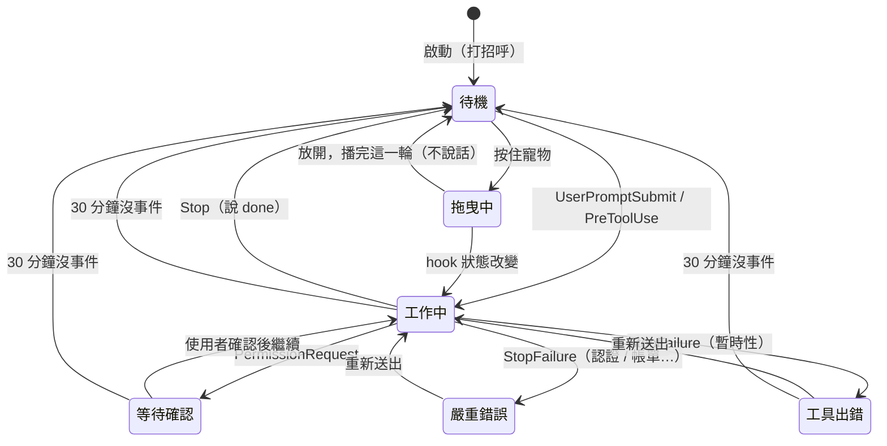

# PawPeek 動作與說話規格

> 這份文件是寵物「什麼時候做什麼動作、說什麼話」的**唯一規格**。
> 修改狀態、動畫、泡泡、台詞、互動（拖曳 / 單擊 / 雙擊 / 縮放）、自言自語、更新提醒等相關程式前先讀這份，
> 改完把變動同步回來（含「變更紀錄」）。程式與文件不一致時，以使用者確認過的這份規格為準，再修程式。

## 0. 總覽

細節見後面各章；這裡把狀態、循環與寵物的變化集中成一頁。

### 0.1 狀態總表

| 狀態 | 前端名稱 | 怎麼進入 | 怎麼離開 | 主動畫（列・格數・一輪） | 進入時說 | 停留時的台詞 | 自言自語時的動作 | 單擊時的動作 | 優先 |
|------|---------|---------|---------|------------------------|---------|-------------|----------------|-------------|------|
| 待機 | `idle` | `Stop`、`SessionStart`、`Notification`（idle_prompt）、30 分鐘逾時、拖曳放開 | 任何 hook 狀態改變；按住寵物 | `idle`・0・6 格・約 6.6 秒（慢速） | 從工作中回來：`done`；從其他狀態回來：`chatter.idle`；剛啟動：不說（接打招呼）；拖曳回來：不說 | 無持久台詞 | 隨機 `jumping` / `waving` / `review` 5 秒 | 隨機 `waving` / `jumping` / `waiting` / `review` 2 秒 | 5（最低） |
| 拖曳中 | `dragging` | 待機時按住 >150ms 或開始移動；非待機時按著直到轉回待機 | 放開後播完這一輪 `jumping` → 待機；hook 狀態改變 → 直接切過去 | `jumping`・4・5 格・0.84 秒，往左水平翻轉 | `chatter.dragging`（持久） | 同左，一直顯示 | 不說 | 不會發生（按著就是拖曳） | 屬於待機底下 |
| 工作中 | `running` | `UserPromptSubmit`、`PreToolUse`、`PostToolUse`、`PreCompact`、未中斷的 `PostToolUseFailure` | 其他 hook；30 分鐘沒事件 → 待機 | `running`・7・6 格・0.82 秒 | `state_bubble.running`（持久） | 持久台詞；自言自語 `chatter.running` 暫時蓋過 4 秒 | 不換動作 | 只說話 | 4 |
| 等待確認 | `waiting` | `PermissionRequest`、`Notification`（permission_prompt / elicitation_dialog） | 其他 hook；30 分鐘沒事件 → 待機 | `waiting`・6・6 格・約 1.0 秒 | `state_bubble.need_confirm`（持久） | 同上，`chatter.waiting` | 不換動作 | 只說話 | 1（最高） |
| 工具出錯 | `review` | `StopFailure`（rate_limit、server_error、未知） | 其他 hook；30 分鐘沒事件 → 待機 | `review`・8・6 格・約 1.0 秒 | `state_bubble.tool_error`（持久） | 同上，`chatter.review` | 不換動作 | 只說話 | 3 |
| 嚴重錯誤 | `failed` | `StopFailure`（認證、帳單、模型、invalid_request 等） | 只有下一次 hook 事件（不逾時） | `failed`・5・8 格・約 1.2 秒 | `state_bubble.error_final`（持久） | 同上，`chatter.failed` | 不換動作 | 只說話 | 2 |

- 「優先」是多對話合併時的順序，數字小的贏。
- 所有狀態都能雙擊（`dblclick.*` 暫時 3 秒）與 `[` / `]` 縮放（特殊 1.5 秒）。
- 每次換動畫至少停 800ms，期間只保留最後一個切換。
- `running-right` / `running-left`（列 1 / 2）目前沒用到。

### 0.2 狀態之間怎麼切換



- 圖上只畫常見路徑；實際上任何 hook 狀態都能直接切到任何狀態（依 §1.1 的觸發）。
- 非待機時按住寵物：只移動視窗，保留原動畫；轉回待機時若還按著，直接進拖曳中。

### 0.3 各狀態內部的循環

每個狀態都是「主動畫一直循環」，中間被小動作或台詞暫時插入，結束後回到主動畫。

**待機**

```
idle 循環 ──┬─ 自言自語（滿 20 秒後每 10 秒擲骰）→ jumping / waving / review 其一 5 秒 ─┐
            ├─ 單擊 → waving / jumping / waiting / review 其一 2 秒（期間不接受單擊）──┤
            ├─ 按住 → 拖曳中：jumping（依方向翻轉）→ 放開播完一輪 ─────────────────┤
            └──────────────────────────────────────────────────────────────────── 回 idle 循環
```

**工作中 / 等待確認 / 工具出錯 / 嚴重錯誤**

```
主動畫循環 + 持久台詞 ──┬─ 自言自語 → 換成 chatter.<狀態> 4 秒，動畫不變 ─┐
                        ├─ 單擊 → chatter.<狀態> 4 秒，動畫不變 ──────────┤
                        └──────────────────────── 回到持久台詞（不重打字）
```

**自言自語的頻率**（所有狀態共用，拖曳中與特殊泡泡期間不說）

| 停留時間 | 每 10 秒說話機率 |
|---------|----------------|
| 0～20 秒 | 不說 |
| 20 秒～5 分鐘 | 40% |
| 5～30 分鐘 | 15% |
| 30 分鐘～2 小時 | 5% |
| 超過 2 小時 | 不說 |

兩句之間至少隔 20 秒。

### 0.4 寵物的變化一覽

| 類別 | 變化 | 何時發生 |
|------|------|---------|
| 動畫 | 切換主動畫 | 狀態改變（§1） |
| 動畫 | 插入小動作 | 待機自言自語 5 秒、待機單擊 2 秒 |
| 外觀 | 水平翻轉 | 拖曳中往左移動 ≥6px；離開拖曳取消 |
| 外觀 | 縮放 | `[` / `]` |
| 外觀 | 換皮膚 | F1 面板（§3.5）、`/set-skin`、`/skin`、啟動時讀 `PET_SKIN` |
| 外觀 | 小寵物 | F3 開關：右下角三隻同皮膚小寵物排成三角形；待機各自動作，其他狀態跟主體一致（§3.6） |
| 位置 | 移動視窗 | 拖曳（任何狀態都能移動；macOS 除外） |
| 泡泡・特殊 | 打招呼 / 告別 / 縮放 / 外觀 / 更新提醒 | §3.4；會擋住其他台詞 |
| 泡泡・暫時 | 進入待機的一句、自言自語、單擊、雙擊 | 3～4 秒後回持久台詞或淡出 |
| 泡泡・持久 | `state_bubble.*`、拖曳台詞 | 一直顯示到狀態改變 |
| 泡泡・資料夾 | 第一行 `📁 資料夾` | 完成、等待確認、出錯時，知道是哪個對話就加（§3.1.1） |
| 面板 | F1 換外觀 / F4 快捷鍵說明 / Esc 離開 | 同鍵開關，一次一個（§3.5） |

## 1. 狀態

### 1.1 Claude Code 狀態（hook → 狀態機）

hook 事件的對應在 `src/hook.rs`，多對話合併在 `src/state.rs`，前端狀態名稱由 `src/daemon.rs` 的 `state_name` 轉換。

| 狀態 | 前端名稱 | 觸發 | 動畫 | 持久台詞（`state_bubble`） |
|------|---------|------|------|---------------------------|
| 待機 | `idle` | `Stop`、`SessionStart`、`Notification`（idle_prompt 等）、逾時重置 | `idle` | 無 |
| 工作中 | `running` | `UserPromptSubmit`、`PreToolUse`、`PostToolUse`、`PreCompact`、未中斷的 `PostToolUseFailure` | `running` | `running` |
| 等待確認 | `waiting` | `PermissionRequest`、`Notification`（permission_prompt / elicitation_dialog） | `waiting` | `need_confirm` |
| 工具出錯 | `review` | `StopFailure`（rate_limit、server_error、未知錯誤） | `review` | `tool_error` |
| 嚴重錯誤 | `failed` | `StopFailure`（認證、帳單、模型、invalid_request 等） | `failed` | `error_final` |

- 多對話時取最高優先：`等待確認 > 嚴重錯誤 > 工具出錯 > 工作中 > 待機`。
- **等待確認怎麼解除**（那個對話）：
  - 選選項 / 允許：工具有結果時解除（`PostToolUse`，或對話紀錄先寫入工具結果）→ 工作中。允許後工具跑很久時，跑完才解除（按允許的當下 Claude Code 不送事件）。
  - 按 Esc 取消：Claude Code **不送任何事件**，只在對話紀錄（hook 的 `transcript_path`）寫入 `[Request interrupted by user…]`。等待確認時每秒檢查新增的內容，看到就 → 待機（`StateMachine::poll_transcripts`）。沒有 `transcript_path` 的 agent（Copilot）不偵測。
  - 送出新訊息（`UserPromptSubmit`）、其他任何事件、`SessionEnd`：照一般對應。
  - 點一下寵物：清掉目前這則提示，見下方「待確認名單」。
- **待確認名單**：每個要求確認的對話依先後排隊，泡泡只顯示**最早那一個**（資料夾名稱見 §3.1.1）；它解除後換下一個，重新說一次 `need_confirm`；名單空了才回到其他狀態。已在等的對話再送一次確認事件（例如 `PermissionRequest` 後又來 `Notification`）不改順序。
  - 點一下寵物（等待確認時）：那個對話回到確認前的狀態（通常是工作中），換下一則。仍繼續看它的對話紀錄，之後按 Esc 會轉成待機。
- 工作中 / 等待確認 / 工具出錯超過 30 分鐘沒有任何事件，自動回到待機（`STALE_TIMEOUT`）；嚴重錯誤保留到下一次操作。
- 對話結束：收到 `SessionEnd`，或（Windows / macOS）執行 hook 的 agent 程序已經結束（每 5 秒檢查，見下方 Copilot 一節）。
- **只在程式關掉才離開**（Windows / macOS）：對話結束不等於離開。寵物記下每個對話的 agent 程序（Claude Code CLI 是 `claude.exe`（macOS 為 `claude` 或 `node`）、VS Code Copilot 是 `copilot-runtime.exe`、Copilot CLI 是 `node.exe`），**沒有對話、而且這些程式都關掉了**才告別、離開（`StateMachine::update_exit`、`lingering`）。
  - 例：VS Code 開新聊天（舊聊天送 `SessionEnd`）→ 不離開；關掉 VS Code → 5 秒內離開。
  - 例：Claude Code CLI 打 `/exit` 或一次性模式（`-p`）跑完 → `claude.exe` 本身結束，算程式關掉 → 離開。
  - 找不到 agent 的對話（Windows / macOS / Linux 以外、程序鏈斷掉）結束時，維持「對話數變 0 就離開」。
  - 手動離開：Esc 面板的「👋 離開」或 `/pawpeek:quit`。

#### GitHub Copilot（🧪 測試中，尚未正式支援）

VS Code Copilot 與 Copilot CLI 會載入同一份 `hooks/hooks.json`（Claude 格式插件）。大部分事件送的是與 Claude Code 相容的 snake_case 資料，對應與上表相同；差異如下（Copilot CLI 實測）：

| Copilot 事件 | 資料格式 | 狀態 | 說明 |
|-------------|---------|------|------|
| `SessionStart`（`source` 為 `new` / `resume`…） | 相容 | 開始（打招呼） | matcher 加了 `new` |
| `UserPromptSubmit`、`PreToolUse`、`PostToolUse`、`PostToolUseFailure`、`PreCompact` | 相容 | 工作中 | |
| `permissionRequest` | 原生（`hookName`、`sessionId`） | 工作中 | **每次工具呼叫前都會送**，不代表跳出確認框，所以不算等待確認 |
| `notification`（`permission_prompt` / `elicitation_dialog`） | 原生 | 等待確認 | 預期才是真正的確認框訊號（尚未實測） |
| `Stop` | 相容 | 待機（完成） | Copilot CLI `-p` 模式結束時偶爾收不到 |
| `ErrorOccurred` | 相容 | `recoverable` 為 false → 嚴重錯誤；其他 → 工具出錯 | Copilot 沒有 `StopFailure` |
| `SessionEnd` | 相容 | 結束（告別） | VS Code：開新聊天時會對被取代的舊聊天送出 |

- VS Code Copilot（從本機資料夾載入插件實測）：`SessionStart` → `UserPromptSubmit` → `PreToolUse` / `permissionRequest` / `PostToolUse` → `Stop`，完成時會回到待機，動作切換與 Claude Code 相同。
- **agent 結束就當作對話結束**（Windows / macOS）：hook 會附上執行它的 agent 程序 PID（往上跳過 powershell、cmd、sh、bash、zsh 等殼層，例如 `claude.exe`、VS Code 的 `copilot-runtime.exe`、Copilot CLI 的 `node.exe`；macOS 用 `ps` 查程序表與啟動時間、`kill(pid, 0)` 判斷是否還在）。桌寵記下 PID 與啟動時間，**每 5 秒檢查一次**，程序不在了就把它的對話當作收到 `SessionEnd`；已經沒有對話、只剩程式開著的 agent 也一起檢查，全部關掉才告別、離開（見上方「只在程式關掉才離開」）。關掉 VS Code 或終端機時常常不會送 `SessionEnd`，靠這個收尾。見 `src/agent.rs`、`StateMachine::end_dead_agents`。
- **結束事件不啟動桌寵**：桌寵沒在跑時收到 `SessionEnd`，hook 直接忽略（沒在跑就代表沒有要結束的對話）。否則會為了轉交結束事件把桌寵叫起來，它發現沒有對話又馬上離開，多閃一次。見 `src/main.rs` `read_stdin_and_send`。

- hook 指令：Claude Code 用 `command`（sh 啟動器），Copilot 在 Windows 用 `powershell` 欄位直接執行 `pawpeek.exe`；Copilot 不支援 `args`。
- Copilot 的 `PreToolUse` hook **失敗會擋下工具呼叫**，所以 hook 模式在任何情況下都要結束碼 0、stdout 不輸出（含不支援的作業系統）。
- 測試方式見 [PLUGIN.md](../PLUGIN.md)「用真的 agent 測試 hook」。
- Copilot 把 hook 放進不允許脫離的 Job Object，hook 結束就連同子程序一起關掉（實測：寵物每個 hook 出現一次、1～8 秒後消失）。
  所以常駐程式的啟動順序是：脫離 Job（`CREATE_BREAKAWAY_FROM_JOB`，Claude Code 用這個）→ 不允許時請 WMI 代為啟動（Copilot，寵物約晚 3 秒出現）→ 都不行才用一般方式。見 `src/daemon.rs` `start_detached_daemon`。

### 1.2 前端狀態

| 狀態 | 說明 | 動畫 |
|------|------|------|
| 上表五種 | 跟著 Claude Code 狀態 | 見上表 |
| `dragging`（拖曳中） | 只能從待機進入，見 §4 | `jumping`，依滑鼠左右方向水平翻轉 |

### 1.3 動畫列（spritesheet 8 欄 × 9 或 11 列）

| 動畫 | 列 | 用途 |
|------|----|------|
| `idle` | 0 | 待機 |
| `running-right` / `running-left` | 1 / 2 | （目前未使用） |
| `waving` | 3 | 待機自言自語、單擊的小動作 |
| `jumping` | 4 | 拖曳中（依方向翻轉）；待機自言自語、單擊的小動作 |
| `failed` | 5 | 嚴重錯誤 |
| `waiting` | 6 | 等待確認；單擊的小動作 |
| `running` | 7 | 工作中 |
| `review` | 8 | 工具出錯；待機自言自語、單擊的小動作 |

- 每個動作至少播 800ms（`MIN_HOLD_MS`），期間的切換只保留最後一個，避免閃爍。

## 2. 泡泡的三層

高的會擋住低的。實作在 `src/bubble.rs` 的 `speech`。

| 層 | 內容 | 顯示方式 | API |
|----|------|---------|-----|
| **特殊**（最高） | 打招呼、告別、縮放提示、外觀提示、更新提醒 | 只顯示一次；期間暫時台詞、持久台詞都不顯示（狀態動畫照常切換，持久台詞等特殊結束後才補上） | `speech.special(text, ms, untilChange)` |
| **暫時** | 進入待機的一句、自言自語、單擊、雙擊 | 時間到後回到持久台詞或淡出 | `speech.say(text, ms)` |
| **持久** | 工作中等狀態的 `state_bubble`、拖曳台詞 | 一直顯示到狀態改變 | `speech.enter(base, entry)` |

### 2.1 顯示效果

- 出現：淡入後逐字打字（45ms／字），打完後 1 秒掃光第一次，之後每 7 秒掃一輪（一輪 2.5 秒、從左到右；emoji 保留原本彩色，不被掃光染白）。不掃的時候文字靜止（持續掃光每幀都要重畫，WebView2 約吃 40% 一顆核心）。結尾是 `...` / `…` 的文字改成點點動畫。
- 換句話：舊泡泡先淡出（200ms），再淡入新泡泡打字。
- 消失：淡出（200ms）。
- 回到持久台詞（暫時台詞結束後）：直接顯示完整文字，不重打。

## 3. 說話條件

### 3.1 切換狀態一定說一句

| 進入的狀態 | 說什麼 | 層 |
|-----------|-------|----|
| 工作中 / 等待確認 / 工具出錯 / 嚴重錯誤 | `state_bubble.<狀態>` | 持久 |
| 待機（從工作中回來） | `done` 隨機一句（有資料夾名稱時第一行加 `folder.tag`，見 §3.1.1） | 暫時 4 秒 |
| 待機（從其他狀態回來） | `chatter.idle` 隨機一句 | 暫時 4 秒 |
| 待機（剛啟動） | 不說（打招呼會接著出現） | — |
| 拖曳中 | `chatter.dragging` 隨機一句 | 持久 |
| 拖曳中 → 待機 | 不說（拖曳屬於待機底下的動作） | — |

- 切換狀態時，正在說的暫時台詞立刻停下，自言自語重新計時。

#### 3.1.1 顯示是哪個資料夾的對話

多個對話（例如 VS Code 與終端機各開一個）同時在跑時，用來分辨是哪個專案完成或在等你。

- 來源：hook 資料的 `cwd`，取最後一層資料夾名稱（`C:\work\pawpeek` → `pawpeek`）。每個對話各自記住（`src/state.rs` `folder_name`）。
- **等待確認**：一律顯示待確認名單的第一個（§1.1），換下一則時跟著換、重新顯示。
- **其他狀態（哪個對話）**：合併狀態改變的那一刻決定（`StateMachine::update_current_state`）：
  1. 觸發這次事件的對話正處於新狀態 → 用它（例如 B 要求確認 → B）。
  2. 否則處於新狀態的對話只有一個 → 用那個（例如 B 完成後回到工作中，工作中的是 A → A）。
  3. 都分不出來（例如逾時一起回到待機、好幾個對話同狀態）或沒有 `cwd` → 不顯示。
- **顯示在哪**：泡泡**第一行**加 `folder.tag`（預設 `📁 {folder}`），只用在：
  - 完成：工作中 → 待機的 `done` 那一句。
  - 等待確認、工具出錯、嚴重錯誤的持久台詞（自言自語 / 單擊的暫時台詞蓋過後，回到持久台詞時仍帶著）。
  - 工作中、其他回到待機的情況不顯示。
- `folder.tag` 清空就完全不顯示。
- 只顯示文字，**一律不搶焦點、不切換視窗**。

### 3.2 自言自語：停留在同一個狀態才會說（不限待機）

- 從進入狀態起滿 20 秒後，每 10 秒擲一次。
- 機率：停留 5 分鐘內 40%、30 分鐘內 15%、之後 5%；停留超過 2 小時不再說。
- 兩句之間至少隔 20 秒（進入狀態那一刻也算一句）。
- 台詞取 `chatter.<狀態>`，暫時 4 秒；待機時另外隨機做 `jumping` / `waving` / `review` 其中一個動作 5 秒。
- 不說的時候：拖曳中、特殊泡泡顯示中（含更新提醒）。

### 3.3 互動

| 操作 | 條件 | 說什麼 | 動作 |
|------|------|-------|------|
| 單擊（等你確認時） | 放開後 250ms 內沒有第二下 | 不說；清掉目前這則待確認提示，換下一則或回到其他狀態（§1.1 待確認名單） | 無 |
| 單擊 | 等你確認以外的狀態；放開後 250ms 內沒有第二下才算單擊（避免雙擊時先冒出單擊台詞）；特殊泡泡顯示中不說 | `chatter.<目前狀態>` 隨機一句（拖曳中視為待機），暫時 4 秒 | 待機時隨機 `waving` / `jumping` / `waiting` / `review` 2 秒，期間不接受下一次單擊 |
| 雙擊 | 任何狀態；會取消等待中的單擊；特殊泡泡顯示中不說 | `dblclick.<狀態>`（對話數與狀態），暫時 3 秒 | 無 |
| `[` / `]` 縮放 | 點過寵物取得焦點後；在 F1 面板輸入框打字時不算 | `zoom.changed`，特殊 1.5 秒 | 無 |
| F1 | 點過寵物取得焦點後 | 不說；開關換外觀面板，見 §3.5 | 無 |
| F3 | 點過寵物取得焦點後 | 打開說 `minis.on`、關閉說 `minis.off`（隨機一句），暫時 3 秒；特殊泡泡顯示中不說；見 §3.6 | 無 |
| F4 | 點過寵物取得焦點後 | 不說；開關快捷鍵說明，見 §3.5 | 無 |
| Esc | 點過寵物取得焦點後；輸入法選字中不算 | 不說；其他面板開著時關閉它，否則開關離開面板，見 §3.5 | 無 |
| F5 / Ctrl+R | — | 沒有作用：瀏覽器快捷鍵（重新整理、尋找、列印等）全部關閉，避免重新整理讓寵物狀態歸零；輸入框的複製貼上不受影響 | 無 |
| 拖曳 | 見 §4 | | |

### 3.4 特殊泡泡

| 內容 | 觸發 | 時間 |
|------|------|------|
| 打招呼 `greeting` | 對話數從 0 變多，或待機中有新對話加入 | 3 秒 |
| 告別 `goodbye` | 要離開時：沒有對話、程式也都關掉（§1.1；嚴重錯誤時不說） | 4 秒 |
| 縮放 `zoom.changed` | `[` / `]` | 1.5 秒 |
| 外觀：讀圖失敗 `skin.image_error` | 啟動時 `PET_SKIN` 圖片讀不到 | 4 秒 |
| 外觀：下載中 / 完成 / 找不到 / 網路錯誤 | 從 Petdex 下載外觀 | 5 / 3 / 4 / 4 秒 |
| 外觀：切換完成 `skin.changed` 等 | `/set-skin`、`/skin`、F1 面板 | 3～4 秒 |
| 外觀：F1 面板失敗 `panel.not_found` / `network_error` / `bad_image` / `save_error` | F1 面板輸入的外觀換不成（保留目前外觀） | 4 秒 |
| 更新提醒 `update.available` | 見 §5 | 直到狀態改變 |

- 新的特殊泡泡會直接取代正在顯示的特殊泡泡。

### 3.5 面板（F1 換外觀 / F4 快捷鍵說明 / Esc 離開）

共通規則：

- **開關**：點過寵物取得焦點後按對應的鍵打開，**同一個鍵再按一次關閉**。面板上**沒有 ✕ 關閉鈕**。
- **一次只開一個**：開著一個時按另一個面板的鍵，直接換成那一個。
- **Esc**：F1 / F4 面板開著時按 Esc 是關閉它（不會接著開離開面板）；沒有面板時打開離開面板；離開面板開著時再按關閉。
- **位置**：放在泡泡的位置（寵物上方；靠近螢幕頂端時在下方），外框與泡泡相同。面板開著時泡泡先藏起來，關閉後照常顯示。
- 面板算在可點範圍內（§4.1），但在面板上按不會拖曳、也不觸發單擊 / 雙擊。
- 實作：前端 `togglePanel('skin' | 'help' | 'quit')`（`src/webview.rs`，`body` 的 `data-panel` 決定顯示哪個）。

**F1 換外觀**（輸入框一行，下面一行並排兩個按鈕：左「Petdex」、右「匯入」；沒有縮放、沒有離開）：

- 輸入框：輸入 Petdex 寵物名稱（也接受圖片路徑或 `default`），按 Enter 送出，**送出後面板立刻關閉**；空白不送出。打開時游標自動在輸入框。
- 「📁 匯入」按鈕（`panel.import`）：跳出選檔視窗（與 `/skin` 相同流程），**按下後面板關閉**。
- 「🌐 Petdex」按鈕（`panel.petdex`）：用預設瀏覽器開 <https://petdex.dev/>，**按下後面板關閉**。送 `openPetdex` 給主程式，網址固定在 `src/daemon.rs` `PETDEX_URL`（前端不帶網址）。
- **內建文字改短時**：使用者檔案裡還是舊預設的欄位（沒自己改過）啟動時會換成新預設，改過的不動；對照表在 `src/config.rs` `OLD_DEFAULTS`（例如 `panel.import` 舊預設「📁 匯入自訂外觀…」）。
- **輸入名稱的結果**：本機已有就直接換；沒有就從 Petdex 下載，`skin.downloading` 一直顯示到下載結束，成功顯示 `skin.installed`。找不到、網路錯誤、圖片不符時**保留目前外觀、不改 `.env`**，顯示 `panel.*` 提示 4 秒。
- 送 `setSkin` / `importSkin` 給主程式；換外觀在 `src/daemon.rs` `set_skin_from_panel`。

**F4 快捷鍵說明**：

- 標題 `help.title`，同一列右上角顯示目前版本號（`v1.3.11` 這種格式，取自 `Cargo.toml`，不能自訂）；下面是兩欄的說明表，來自 `help.keys`（`"按鍵": "說明"`，依檔案順序一行一列；可自行增刪改）。只有說明、沒有按鈕。
- 舊版的 `help.text`（單一多行字串）不再讀取；使用者檔案升級後會補上 `help.keys`，舊的 `help.text` 留著不用。

**Esc 離開**：

- 標題 `panel.quit_title`，一個「👋 離開」按鈕（`panel.quit`，滑過提示 `panel.quit_hint`）。
- 按下：讓寵物離開，與 `/pawpeek:quit` 相同（不說告別、立刻結束；之後只有新對話開始 `SessionStart` 才會再出現）。Copilot 沒有指令可用，靠這個關閉。
- 只按 Esc 不會離開，一定要點按鈕。

### 3.6 小寵物（F3）

- **F3** 開關：在寵物右下角、**寵物圖層上方**疊三隻小寵物（寬高為寵物方框的 28%），同一個鍵再按一次關閉。小寵物本身不說話、沒有泡泡，不影響面板；打開 / 關閉時主體說一句 `minis.on` / `minis.off`（暫時 3 秒，特殊泡泡顯示中不說）。
- **站位**：在寵物右下角排成**三角形**，每次打開時 ▲（上一下二）/ ▼（上二下一）輪流（第一次隨機），各隻再隨機偏移 ±4%。三角中心約在寵物寬度 83%（右下角偏內）、上排頂在寵物高度 64%、下排 78%（底部略低於寵物底邊）；同排兩隻中心距 32%（寬度 28%），上下排斜向**稍微重疊**，下排疊在上排前面。都在視窗預留的空白內，跟著 `[` / `]` 一起縮放。
- **動作**：
  - **主體待機**：三隻各自播（從隨機一格開始，不同步）。主體做小動作（自言自語 5 秒、單擊 2 秒）時，三隻各換一個**不同的**動作（`jumping` / `waving` / `review` / `waiting` 隨機分配）同樣長度；另外每 4 秒每隻有 15% 機率自己做個小動作 2～4 秒。
  - **主體在其他狀態**（工作中、等待確認、工具出錯、嚴重錯誤、拖曳中）：三隻和主體畫同一格，動作一致；拖曳往左時各自水平翻轉（站位不鏡像）。
  - 皮膚永遠和主體相同（換外觀一起換）。
- 小寵物算在視窗形狀內（§4.1），按在上面等於按在寵物上（拖曳、單擊、雙擊）。
- 不記住開關：重新啟動後是關的。
- 實作：`src/webview.rs` `MINIS_JS`（`toggleMinis`、`setMinisFollow` 由 `enterMode` 呼叫、`minisAction` 由 `playAction` 呼叫；`body.minis`、`#minis` 裡三個 canvas）。

## 4. 拖曳

- **進入**：在可點範圍（§4.1，寵物方框與顯示中的泡泡）按住超過 150ms，或一開始移動，就進入拖曳（比 150ms 短就放開算單擊）。
  - 待機時：切到「拖曳中」，播 `jumping` 並說 `chatter.dragging`（持久）。
- **方向**：拖曳中一律播 `jumping`，依滑鼠水平方向翻轉畫面（CSS `scaleX(-1)`）。
  - 往右：原圖；往左：水平翻轉。
  - 同方向累積移動超過 6px 才換方向（避免手抖左右閃）；停下來保持最後的方向；只上下移動不換方向。
  - 離開拖曳（回待機或切到其他狀態）時取消翻轉。
  - 非待機時：可以移動，但保留原本狀態的動畫與台詞；**轉回待機時若仍按著，直接接上拖曳**。
- **放開**：拖曳動作**完整播完這一輪**才回待機，回待機不說話；拖曳台詞隨之淡出。
- Claude 狀態在拖曳中改變（例如開始工作）：直接切到新狀態，拖曳結束。
- macOS 不走這段拖曳邏輯。

## 4.1 可點範圍（Windows）

- 視窗只保留寵物矩形（`.pet`，192×208 比例、含縮放）、F3 小寵物（開著時，§3.6）與**顯示中的泡泡**（含尾巴，外擴 9px）；預留給泡泡的其餘透明空間一律穿透，點到底下的視窗。
- **可拖曳區 = 可點區 = 視窗形狀**：擋住滑鼠的地方都能拖曳、單擊、雙擊，不會有「擋住但沒反應」的地方。泡泡顯示時，按在泡泡上也等於按在寵物上（前端 `inHitArea` 用同一份矩形判斷）。
- 做法：前端 `reportHitRects`（`CONTROLLER_JS`）回報矩形（`hitRects`，視窗內 CSS 像素；變動才送，用 ResizeObserver 加每 100ms 檢查），原生端用 `SetWindowRgn` 把視窗裁成這些矩形（`src/daemon.rs` `set_hit_region`）。
- 視窗因泡泡或縮放改變大小時，先還原成整個視窗，等前端重新回報，避免寵物被舊形狀裁到。
- 限制：看得到的地方一定會擋滑鼠。不能用 `WS_EX_LAYERED | WS_EX_TRANSPARENT` 做「看得到但穿透」：這個視窗是 NOREDIRECTIONBITMAP（透明背景需要，拿掉會變白底），變成 layered 後畫面會停住、寵物消失（建立時就設或中途設都一樣）。
- 還沒收到矩形（剛啟動）時整個視窗可點。macOS 不處理。

## 5. 更新提醒

- 桌寵**每次啟動**時檢查一次（啟動 5 秒後讀 GitHub 上的 `bin/VERSION`），比目前版本新才提醒；`.env` 設 `UPDATE_CHECK=off` 關閉。
- 在**第一次待機**時以特殊泡泡顯示；啟動時正在工作就先暫存，等第一次回到待機。
- 顯示期間：待機的自言自語暫停；單擊、雙擊不顯示。
- **狀態改變（含開始拖曳）就結束**，這次執行不再出現；下次啟動會再檢查、再提醒。

## 6. 台詞來源（`messages.json`）

使用者的檔案在「文件」下的 `.pawpeek/messages.json`。陣列會隨機挑一句。

桌寵**每次啟動**時依兩種情況處理這個檔案（`src/config.rs` `ensure_files`）：

| 情況 | 處理 |
|------|------|
| 檔案不存在 | 用內建預設（`assets/messages.json`）產生一份 |
| 檔案已存在 | **只補上缺的 key**（遞迴比對每一層），寫回檔案；使用者改過的值、型別（字串 / 陣列）一律保留，**不會整個還原**；原本的欄位順序保留，新 key 接在同一層最後面 |

- 檔案裡不放註解；欄位與 `{參數}` 的說明寫在 `README.md`〈自訂台詞〉。舊版範本最上層的 `_說明` 啟動時會從使用者檔案移除（只移除這個 key）。
- **新增或改動 `{參數}` 時**：同步更新下表與 `README.md`〈自訂台詞〉。
- 沒有缺 key、也沒有舊 `_說明` 要移除就不寫檔。檔案格式錯誤（不是合法 JSON）時不動它，讀取時改用內建預設。
- 讀取時仍會在記憶體裡用內建預設補齊（檔案寫不進去也不會缺字）。
- **新增台詞時**：只要把新 key 加進 `assets/messages.json`，使用者升級後下次啟動就會自動補進他的檔案，不用另外處理。改掉或刪掉既有 key 不會同步（使用者檔案裡的舊 key 會留著、不再讀取）。

| 欄位 | 用途 |
|------|------|
| `state_bubble.running / need_confirm / tool_error / error_final` | 各狀態的持久台詞 |
| `chatter.idle / running / waiting / review / failed / dragging` | 各狀態的自言自語與單擊台詞；`dragging` 是拖曳台詞 |
| `done` | 工作完成回到待機 |
| `greeting` / `goodbye` | 打招呼 / 告別 |
| `dblclick.*` | 雙擊回報（`{count}`、`{state}`） |
| `zoom.changed` | 縮放提示（`{scale}`） |
| `update.available` | 更新提醒（`{latest}`、`{current}`） |
| `skin.*` / `import.*` | 外觀相關提示與對話框 |
| `minis.on / off` | F3 小寵物登場 / 退場時說的一句（§3.6） |
| `panel.*` | F1 換外觀面板的文字（輸入框提示、按鈕）與失敗提示；`quit_title` / `quit` / `quit_hint` 是 Esc 離開面板 |
| `help.title / keys` | F4 快捷鍵說明：標題、說明表（`"按鍵": "說明"`） |
| `folder.tag` | 資料夾名稱（`{folder}`），放在完成 / 等待確認 / 出錯泡泡的第一行；清空不顯示（§3.1.1） |
| `state_label.*` | 雙擊時 `{state}` 顯示的狀態名稱 |

舊版的 `idle`、`click_head`、`click_body`、`drag` 已併入 `chatter`，不再讀取。

## 7. 程式位置

| 內容 | 位置 |
|------|------|
| hook 事件 → 狀態 | `src/hook.rs` `map_hook_event` |
| 多對話合併、優先順序、逾時 | `src/state.rs` |
| agent 程序偵測（結束就當作對話結束） | `src/agent.rs` |
| `messages.json` 產生 / 補缺的 key | `src/config.rs` `ensure_files` |
| 狀態通知、特殊泡泡、打招呼 / 告別、更新檢查 | `src/daemon.rs`（`onHookState`、`speech.special`、`queueUpdate`） |
| 泡泡三層、淡入淡出、打字、掃光 | `src/bubble.rs`（`speech`、CSS） |
| 前端狀態、拖曳、單擊、雙擊、自言自語、更新提醒排隊 | `src/webview.rs` `CONTROLLER_JS` |
| 動畫定義與播放 | `src/webview.rs`（`STATES`、`play`、`afterCycle`） |
| 預設台詞 | `assets/messages.json` |

## 9. 測試版標示

- **測試版**（debug build，`cargo build`）在寵物下方顯示不會消失的 `DEMO`（大寫，外框與泡泡相同：深色底、細邊框、陰影、膠囊圓角），用來分辨正在跑的是不是測試版。
- 位置在寵物方框**內的底部**，置中；不擴大可點範圍（方框外的東西必須算進視窗形狀才畫得出來，見 §4.1）。
- **正式版**（`cargo build --release`，打包與 CI 用的）一律不顯示。
- 這行字不受狀態、泡泡、單擊影響，也不觸發寵物的互動（`pointer-events: none`）。實作在 `src/webview.rs` `build_page` 的 `demo_label`（`cfg!(debug_assertions)`）。
- 要驗證新改動請用 `cargo build` 的測試版跑；`--release` 的結果不會有這行字。
- 測試版預設用 **47391** 埠（正式版 47390），可以和已安裝的正式版同時開著、各收各的事件；環境變數 `PAWPEEK_PORT` 或常駐程式參數 `--port` 可再指定。

## 8. 變更紀錄

| 日期 | 變更 |
|------|------|
| 2026-11-19 | §3.5 F4 快捷鍵說明面板右上角顯示版本號 |
| 2026-11-18 | macOS：補上「agent 程式關掉就結束對話 / 離開」偵測（原本只有 Windows）；F1 面板的 Petdex 按鈕改用 `open` 開瀏覽器；macOS 執行檔改為 universal（支援 Intel Mac） |
| 2026-11-18 | §3.6 F3 打開 / 關閉小寵物時說一句登場 / 退場台詞（暫時 3 秒）；新增 `minis.on` / `minis.off` |
| 2026-11-18 | 新增 §3.6 F3 小寵物：右下角三隻同皮膚小寵物（疊在寵物上方，三角形排列 ▲ / ▼ 輪流、稍微重疊）；主體待機時各自動作（主體小動作時三隻各換不同動作），其他狀態跟主體一致；不說話；§4.1 視窗形狀加入小寵物；`help.keys` 新增 `F3` |
| 2026-11-17 | §2.1 掃光從持續循環改為打完字 1 秒後掃第一次、之後每 7 秒一輪（降低 CPU / GPU 用量）；主程式事件迴圈改成有事件才醒（原本每 5ms 醒一次） |
| 2026-11-17 | §1.1 新增待確認名單：多個對話等確認時依先後顯示，解除一個換下一個（§3.1.1 等待確認改為顯示名單第一個）；按 Esc 取消確認時 Claude Code 不送事件，改看對話紀錄的「被使用者中斷」轉成待機；§3.3 等你確認時單擊改為清掉這則提示（其他狀態不變） |
| 2026-11-17 | §3.5 F1 換外觀面板新增「🌐 Petdex」按鈕，用預設瀏覽器開 https://petdex.dev/，和「📁 匯入」並排一行（Petdex 在左）（`panel.import` 從「📁 匯入自訂外觀…」改短，仍是舊預設的使用者檔案會自動換新）；新增 `panel.petdex` |
| 2026-11-17 | §3.5 F4 快捷鍵說明改成兩欄表格，內容來自 `messages.json` 的 `help.keys`（按鍵 → 說明）；`help.text` 不再使用 |
| 2026-11-17 | §3.3 關閉 WebView2 瀏覽器快捷鍵（F5 / Ctrl+R 重新整理、Ctrl+F、Ctrl+P 等），前端也擋 F5 / Ctrl+R（舊版 WebView2 備援） |
| 2026-11-17 | §6 `messages.json` 拿掉 `_說明` 註解，欄位與 `{參數}` 說明（含可用欄位）改寫在 `README.md`〈自訂台詞〉；已存在的使用者檔案啟動時移除 `_說明` |
| 2026-11-16 | §1.1 改為**只在程式關掉才離開**：對話結束（例如 VS Code 開新聊天）但 agent 程式還開著就不離開，沒有對話且程式都關掉才告別；原本是對話數變 0 就離開（從第一版沿用，2026-11-16 加上 agent 結束偵測後更容易消失）；§3.4 告別時機同步修改 |
| 2026-11-16 | 新增 §3.1.1：完成、等待確認、出錯的泡泡第一行顯示對話的資料夾名稱（hook 的 `cwd`，`folder.tag`），不搶焦點；§3.5 改為三個面板：F1 換外觀拿掉「離開」、新增 F4 快捷鍵說明、Esc 離開面板，同鍵再按關閉（拿掉 ✕ 關閉鈕）、一次只開一個；新增 `folder.tag`、`help.*`、`panel.quit_title`；`panel.close` 不再使用 |
| 2026-11-16 | §6 預設台詞（`assets/messages.json`）從兔子改成通用小動物，拿掉括號裡的動作描述（動作由外觀動畫表現）；`state_label.waving / jumping` 改為「打招呼」「開心中」。已存在的使用者檔案不會被覆蓋 |
| 2026-11-16 | agent 程序結束（沒送 `SessionEnd`）時，5 秒內把它的對話當作結束（Windows），§1.1 補充 |
| 2026-11-16 | §6 `messages.json`：檔案不存在就產生；已存在就只補缺的 key、保留使用者的值與順序（原本只在記憶體補，檔案不會更新） |
| 2026-11-16 | §3.5 F1 面板新增「👋 離開」按鈕（與 `/pawpeek:quit` 相同），面板改為三項；新增 `panel.quit` / `panel.quit_hint` |
| 2026-11-16 | 桌寵沒在跑時收到 `SessionEnd` 不再啟動桌寵（避免 VS Code 開新聊天時多閃一次）；VS Code Copilot 實測有 `Stop`，§1.1 補充；更新提醒 `update.available` 同時寫出 Claude Code 與 VS Code 的更新方式 |
| 2026-11-16 | 修正 Copilot 下寵物反覆出現又消失：常駐程式脫離 hook 的 Job Object（不允許時改由 WMI 代為啟動）；§1.1 Copilot 補充 |
| 2026-11-16 | 測試版（debug build）預設用 47391 埠，可和已安裝的正式版（47390）同時開、各收各的事件 |
| 2026-11-16 | 新增 §3.5 F1 換外觀面板：輸入 Petdex 名稱（Enter 送出後關閉）、匯入自訂外觀（按下後關閉）、F1 / ✕ / Esc 關閉；面板輸入時 `[` / `]` 不縮放；新增 `panel.*` 台詞 |
| 2026-11-16 | 寵物出現時不搶焦點（Windows）：視窗先隱藏、以不啟用方式顯示，WebView2 建立時也不取得焦點；點過寵物才取得焦點 |
| 2026-11-16 | 🧪 GitHub Copilot 支援（測試中）：§1.1 新增 Copilot 事件對應；hook 指令改成 `command` + `powershell`（不用 `args`）；新增 `ErrorOccurred`；Copilot 的 `permissionRequest` 視為工作中 |
| 2026-11-16 | 新增 §9 測試版標示：測試版（debug build）在寵物方框底部顯示不消失的 `DEMO`（泡泡外框），正式版不顯示 |
| 2026-11-16 | 可點範圍只限寵物矩形與顯示中的泡泡，預留的空白處滑鼠穿透到底下視窗（Windows）；拖曳、單擊、雙擊與可點範圍一致（泡泡上也能拖曳、點擊）；新增 §4.1 |
| 2026-11-11 | 掃光時 emoji 保留原本彩色（原本會變成白色剪影） |
| 2026-11-11 | 新增 §0 總覽：狀態總表、狀態切換圖、各狀態內部循環、寵物變化一覽（只整理文件，行為不變） |
| 2026-11-10 | 拖曳中的 `jumping` 依滑鼠左右方向水平翻轉；單擊等 250ms 確認不是雙擊 |
| 2026-11-10 | 建立本文件。說話改為三層（特殊 / 暫時 / 持久）；切換狀態一定說一句；自言自語不限待機；單擊依目前狀態說話；拖曳在按下時進入、放開等動作播完才回待機；換句話改為淡出；修正掃光隔輪重置；新增更新提醒；台詞改為 `chatter.<狀態>` |
